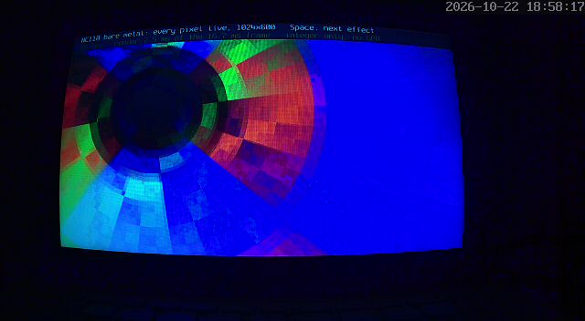

# NC110 agentic OS



*The real netbook (camera photo): graphics mode (home key G) at 60 fps, no GPU and no OS underneath.*

A bare-metal operating system for a 2011 Samsung NC110 netbook (Atom N570, GMA 3150, Intel Centrino 130 WiFi), written in
Rust with no OS underneath. It was built in six days (2026-10-17 to 10-22) by AI coding agents (Claude Code, with Codex as
an independent reviewer), with one person steering and approving each step on the real machine.

## What runs on the netbook today

Everything below is tested on the real hardware, not only in an emulator:

- **Graphics (home key G):** full-screen effects at 60 fps on the native 1024x600 panel. Every pixel is computed on the
  CPU each frame, integer maths only, paced to the panel refresh. The trackpad steers them.
- **WiFi from scratch (W):** a driver for the Intel Centrino 130 (firmware load, calibration, scan) and WPA2-PSK (4-way
  and group key handshakes, CCMP via the card), DHCP. Pick a network, type its password on the netbook.
- **WireGuard client:** Noise IK handshake, BLAKE2s and the transport written here; interoperates with Linux kernel
  WireGuard. Comes up by itself after a WiFi join.
- **SSH client (S):** to a list of pinned hosts, over Ethernet, WiFi or the tunnel.
- **Show and tell (D):** live CPU idle share, power draw (on battery), boot time (about 7 s from power-on), kernel size.
- **Keyboard and trackpad, native screen, 3 text sizes, voice push-to-talk, a remote control channel (`bmctl`,
  authenticated UDP).**

About 12,700 lines of Rust. The kernel image is about 1.3 MB.

## Why try this yourself

Old laptops are full of hardware that nobody will write a driver for again. With a coding agent you can try anyway: the
agent reads the Linux driver and the datasheets, writes the code, and tests it on the machine, while you decide what to
try next and approve anything risky. This repository is a record of that loop, including the dead ends.

## How to try it on your own machine

1. Read `PROVISIONING.md` (how this machine is run and recovered) and `docs/` (driver recipes the agents wrote first).
2. Give your agent this repository and your hardware. Start the same way this one did: a kernel that prints over serial,
   then a watchdog, then one device at a time.
3. Keep a way back. Here that is a hardware watchdog armed by GRUB, a per-day boot budget that falls back to Linux, and
   kernels loaded into RAM over the network for testing, so a bad build never touches the disk.

## Build and run

Two inputs are not in the repository and are needed once: the WiFi firmware (Intel's, from linux-firmware) and a set
of throwaway test keys.

```
rustup target add x86_64-unknown-none        # tested with stable Rust 1.96
mkdir -p fw test-keys
curl -L -o fw/iwlwifi-6000g2b-6.ucode \
  https://git.kernel.org/pub/scm/linux/kernel/git/firmware/linux-firmware.git/plain/intel/iwlwifi/iwlwifi-6000g2b-6.ucode
shasum -a 256 fw/iwlwifi-6000g2b-6.ucode     # 49f2408828b9b8ea3818f487a7c0b736d13879d4fcd21cf1082d41e03fb00e4f
ssh-keygen -q -t ed25519 -N '' -f test-keys/client_ed25519
ssh-keygen -q -t ed25519 -N '' -f test-keys/host_ed25519
python3 tools/extract-keys.py                # -> test-keys/client.key (boot module) and host_pub.bin (compiled in)

NC110_BUILD=$(git rev-parse --short HEAD) cargo build --release --features attended
python3 tools/demo-q35-shot.py out.png target/x86_64-unknown-none/release/nc110-kernel g   # boots it in QEMU (q35) and takes a screenshot
```

`NC110_BUILD` is optional; when set, the home screen shows it under the logo, so you can tell which kernel is running.

On the netbook it boots from GRUB as a multiboot kernel; see `tools/nc110-install-agentos.sh`. Keys, WiFi passwords and
the WireGuard configuration are never in this repository: they live outside it and reach the netbook as boot modules.

## Status

A working demo, not a general-purpose OS. Expect hardware-specific code (this one netbook) and rough edges.

`proof/` keeps the raw record (logs, captures, review transcripts, photos), lightly scrubbed before publishing: MAC
addresses are replaced with placeholders and local paths with `~`.

## License

Per file, mapped in `REUSE.toml` (see `LICENSE`): MIT for most of the kernel and tools; GPL-2.0-only for the Ethernet
and WiFi drivers, which follow the Linux drivers closely (`src/nic.rs`, `src/nic_regs.rs`, `src/wifi.rs`, `src/iwl.rs`);
BSD-2-Clause for the Spleen font. Bring your own network drivers and the rest is MIT. A kernel built with the GPL
drivers is GPL-2.0 as a whole. The WiFi firmware is Intel's and is not included.
